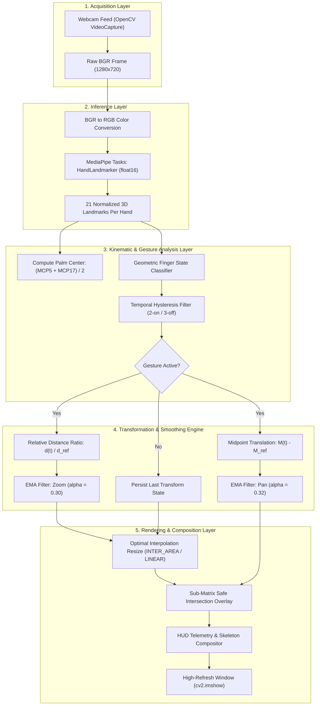

# Gesture-Zoom-cv

  

**Author:** [Cholan Kinnera](https://github.com/Cholan-kinnera)

---

## Executive Overview

**Gesture-Zoom-cv** is a high-performance, real-time computer vision engine engineered to provide intuitive, touchless spatial manipulation of digital imagery using dual-hand kinematic gestures.

Built on Google's modern **MediaPipe Tasks API** (`vision.HandLandmarker`) and **OpenCV**, this project circumvents the legacy `mp.solutions` deprecation barrier by leveraging the native graph-execution runtime and the official `float16` hand landmarker model.

### Key Capabilities

- **Decoupled Kinematic Control**: Independent relative zoom scaling and spatial panning without positional drift.
- **Orientation-Invariant Geometry**: Robust finger curl and extension classification based on palm-relative Euclidean metrics rather than naive vertical coordinates.
- **Sub-Pixel Exponential Smoothing**: First-order exponential moving average (EMA) interpolation eliminates landmark micro-jitter.
- **Persistent State Tracking**: Zero-jump transformation retention across tracking dropouts and gesture pauses.
- **Fault-Tolerant Boundary Clipping**: Dynamic sub-matrix slicing guarantees that manipulated assets never cause shape-mismatch exceptions when crossing webcam frame boundaries.
- **Presentation Dashboard**: Real-time Heads-Up Display (HUD) presenting tracking telemetry, gesture state, distance, scale, and FPS metrics.

---

## System Architecture & Pipeline

Gesture-Zoom-cv operates as an optimized pipeline structured into five modular abstraction layers:

### Pipeline Layer Responsibilities

| Layer | Responsibility | Primary Technologies |
| :--- | :--- | :--- |
| **1. Acquisition** | High-definition camera stream capture (`1280x720` resolution). Non-blocking polling prevents frame buffer queuing. | OpenCV `VideoCapture`, V4L2 |
| **2. Inference** | Hand detection and 21 3D normalized keypoint regression via hardware-accelerated CPU delegate. | MediaPipe Tasks `HandLandmarker` (`float16`), XNNPACK |
| **3. Kinematics** | Pixel-space coordinate projection, palm center extraction, and angle/distance invariant finger state evaluation. | Vector Euclidean geometry |
| **4. Transforms** | Continuous distance ratio computation, decoupled midpoint tracking, and low-pass filtering. | Exponential Moving Average (EMA) |
| **5. Composition** | Sub-matrix intersection clipping, dual-mode interpolation resizing, telemetry rendering, and frame display. | NumPy slicing, OpenCV GUI |

---
