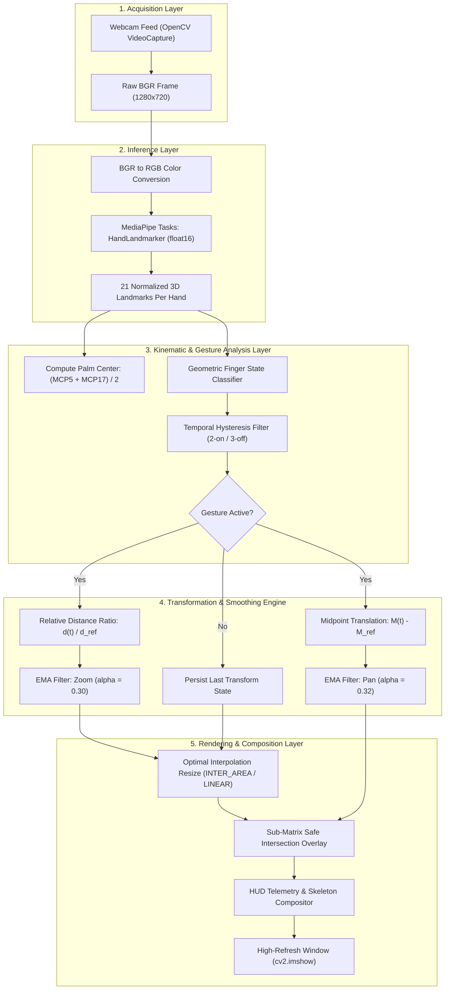

<div align="center">

# Gesture-Zoom-cv

<p align="center">
  
</p>

[](https://www.python.org/)
[](https://developers.google.com/mediapipe)
[](https://opencv.org/)
[](https://endeavouros.com/)
[](LICENSE)

**Author:** [Cholan Kinnera](https://github.com/Cholan-kinnera)

</div>

---

## Executive Overview

**Gesture-Zoom-cv** is a high-performance, real-time computer vision engine engineered to provide intuitive, touchless spatial manipulation of digital imagery using dual-hand kinematic gestures.

Built on Google's modern **MediaPipe Tasks API** (`vision.HandLandmarker`) and **OpenCV**, this project circumvents the legacy `mp.solutions` deprecation barrier by leveraging the native graph-execution runtime and the official `float16` hand landmarker model.

### Key Capabilities

- **Decoupled Kinematic Control**: Independent relative zoom scaling and spatial panning without positional drift.
- **Orientation-Invariant Geometry**: Robust finger curl and extension classification based on palm-relative Euclidean metrics rather than naive vertical coordinates.
- **Sub-Pixel Exponential Smoothing**: First-order exponential moving average (EMA) interpolation eliminates landmark micro-jitter.
- **Persistent State Tracking**: Zero-jump transformation retention across tracking dropouts and gesture pauses.
- **Fault-Tolerant Boundary Clipping**: Dynamic sub-matrix slicing guarantees that manipulated assets never cause shape-mismatch exceptions when crossing webcam frame boundaries.
- **Presentation Dashboard**: Real-time Heads-Up Display (HUD) presenting tracking telemetry, gesture state, distance, scale, and FPS metrics.

---

## System Architecture & Pipeline

Gesture-Zoom-cv operates as an optimized pipeline structured into five modular abstraction layers:



### Pipeline Layer Responsibilities

| Layer | Responsibility | Primary Technologies |
| :--- | :--- | :--- |
| **1. Acquisition** | High-definition camera stream capture (`1280x720` resolution). Non-blocking polling prevents frame buffer queuing. | OpenCV `VideoCapture`, V4L2 |
| **2. Inference** | Hand detection and 21 3D normalized keypoint regression via hardware-accelerated CPU delegate. | MediaPipe Tasks `HandLandmarker` (`float16`), XNNPACK |
| **3. Kinematics** | Pixel-space coordinate projection, palm center extraction, and angle/distance invariant finger state evaluation. | Vector Euclidean geometry |
| **4. Transforms** | Continuous distance ratio computation, decoupled midpoint tracking, and low-pass filtering. | Exponential Moving Average (EMA) |
| **5. Composition** | Sub-matrix intersection clipping, dual-mode interpolation resizing, telemetry rendering, and frame display. | NumPy slicing, OpenCV GUI |

---

## Mathematical Formulation

Gesture-Zoom-cv relies on deterministic geometric modeling to guarantee mathematical consistency, rotational invariance, and numerical stability.

### 1. Palm Center Reference Formulation

To prevent center drift caused by finger articulation or wrist translation, the hand center $\mathbf{C} \in \mathbb{R}^2$ is computed as the midpoint between the Metacarpophalangeal (MCP) joints of the Index finger (landmark 5) and the Pinky finger (landmark 17):

$$\mathbf{C} = \left( \frac{x_{\text{MCP5}} + x_{\text{MCP17}}}{2}, \; \frac{y_{\text{MCP5}} + y_{\text{MCP17}}}{2} \right)$$

This point corresponds directly to the rigid palm biomechanics, remaining invariant to digit extension or curling.

### 2. Relative Distance & Zoom Scaling

When two hands are actively classified, the Euclidean inter-hand distance $d(t)$ at discrete frame $t$ is:

$$d(t) = \|\mathbf{C}_2(t) - \mathbf{C}_1(t)\|_2 = \sqrt{(x_{C2} - x_{C1})^2 + (y_{C2} - y_{C1})^2}$$

Upon gesture entry ($t = t_0$), reference anchors are established:

$$d_{\text{ref}} = d(t_0), \quad Z_{\text{ref}} = Z(t_0 - 1)$$

The raw target zoom factor $Z_{\text{target}}(t)$ is derived proportionally:

$$Z_{\text{target}}(t) = \operatorname{clamp}\left( Z_{\text{ref}} \cdot \frac{d(t)}{d_{\text{ref}}}, \; Z_{\min}, \; Z_{\max} \right)$$

where $Z_{\min} = 0.35$ (35% scale) and $Z_{\max} = 3.50$ (350% scale).

To eliminate landmark jitter while maintaining responsiveness, first-order Exponential Moving Average (EMA) smoothing is applied:

$$Z(t) = Z(t-1) + \alpha_{\text{zoom}} \cdot \left( Z_{\text{target}}(t) - Z(t-1) \right), \quad \alpha_{\text{zoom}} = 0.30$$

### 3. Decoupled Spatial Panning

Translation is driven by the spatial midpoint $\mathbf{M}(t)$ between the two hands:

$$\mathbf{M}(t) = \frac{\mathbf{C}_1(t) + \mathbf{C}_2(t)}{2}$$

The raw target pan position $\mathbf{P}_{\text{target}}(t) = (P_x, P_y)$ is updated relative to the initial midpoint anchor $\mathbf{M}_{\text{ref}}$:

$$\mathbf{P}_{\text{target}}(t) = \mathbf{P}_{\text{ref}} + \left( \mathbf{M}(t) - \mathbf{M}_{\text{ref}} \right)$$

Applying EMA smoothing:

$$\mathbf{P}(t) = \mathbf{P}(t-1) + \alpha_{\text{pan}} \cdot \left( \mathbf{P}_{\text{target}}(t) - \mathbf{P}(t-1) \right), \quad \alpha_{\text{pan}} = 0.32$$

Because $\mathbf{M}(t) - \mathbf{M}_{\text{ref}}$ measures collective translational drift independently of inter-hand distance variation $\|\mathbf{C}_2(t) - \mathbf{C}_1(t)\|$, panning and zooming operate as decoupled degrees of freedom.

### 4. Fault-Tolerant Boundary Clipping

Let the resized image dimensions be $(W_{\text{img}}, H_{\text{img}})$ and the video canvas dimensions be $(W_{\text{canvas}}, H_{\text{canvas}})$. The bounding coordinates on canvas space are:

$$x_1 = \operatorname{round}\left( P_x - \frac{W_{\text{img}}}{2} \right), \quad x_2 = x_1 + W_{\text{img}}$$

$$y_1 = \operatorname{round}\left( P_y - \frac{H_{\text{img}}}{2} \right), \quad y_2 = y_1 + H_{\text{img}}$$

The canvas intersection slice $\mathcal{F}$ and image source slice $\mathcal{O}$ are determined by:

$$\mathcal{F}_x = [\max(0, x_1), \; \min(W_{\text{canvas}}, x_2)], \quad \mathcal{F}_y = [\max(0, y_1), \; \min(H_{\text{canvas}}, y_2)]$$

$$\mathcal{O}_x = [\max(0, -x_1), \; \max(0, -x_1) + (\mathcal{F}_{x2} - \mathcal{F}_{x1})]$$

$$\mathcal{O}_y = [\max(0, -y_1), \; \max(0, -y_1) + (\mathcal{F}_{y2} - \mathcal{F}_{y1})]$$

This mathematical equivalence ensures $\dim(\mathcal{F}) \equiv \dim(\mathcal{O})$ unconditionally, eliminating out-of-bounds matrix slicing exceptions when assets cross screen edges or exceed canvas dimensions.

---

## Gesture Kinematics & Geometric State Machine

### 1. 21-Landmark Biomechanical Topology

```
                  8 [INDEX_TIP]    12 [MIDDLE_TIP]   16 [RING_TIP]   20 [PINKY_TIP]
                     |                 |                |               |
                  7 [DIP]           11 [DIP]          15 [DIP]        19 [DIP]
                     |                 |                |               |
                  6 [PIP]           10 [PIP]          14 [PIP]        18 [PIP]
                     \                 |                |               /
4 [THUMB_TIP]         5 [INDEX_MCP]     9 [MIDDLE_MCP]  13 [RING_MCP]  17 [PINKY_MCP]
      |                      \                 |        /              /
3 [THUMB_IP]                  \----------------+-------+--------------/
      |                                        |
2 [THUMB_MCP]                                  |  [PALM_CENTER = (5 + 17)/2]
      |                                        |
1 [THUMB_CMC] ---------------------------------/
      \
       0 [WRIST]
```

### 2. Geometric Classification Rules

Unlike naive approaches relying on screen $y$-axes, Gesture-Zoom-cv evaluates relative inter-joint distances and vectors:

| Digit | Evaluated Joints | Mathematical Condition | Target State | Description |
| :--- | :--- | :--- | :--- | :--- |
| **Index** | Tip (8), PIP (6), Wrist (0), $\mathbf{C}$ | $\|\mathbf{P}_8 - \mathbf{C}\| > 1.10 \cdot \|\mathbf{P}_6 - \mathbf{C}\| \;\land\; \|\mathbf{P}_8 - \mathbf{P}_0\| > \|\mathbf{P}_6 - \mathbf{P}_0\|$ | **EXTENDED** (1) | Tip is pushed away from palm center and wrist beyond PIP joint. |
| **Thumb** | Tip (4), IP (3), MCP (2), Pinky MCP (17), $\mathbf{C}$ | $\|\mathbf{P}_4 - \mathbf{P}_2\| > 1.05 \cdot \|\mathbf{P}_3 - \mathbf{P}_2\| \;\land\; (\|\mathbf{P}_4 - \mathbf{P}_{17}\| > 1.02 \cdot \|\mathbf{P}_3 - \mathbf{P}_{17}\| \;\lor\; \|\mathbf{P}_4 - \mathbf{C}\| > 0.65 \cdot L_{\text{palm}})$ | **EXTENDED** (1) | Thumb phalanx is straightened and abducted away from the palm. |
| **Middle** | Tip (12), PIP (10), Wrist (0), $\mathbf{C}$ | $\|\mathbf{P}_{12} - \mathbf{C}\| < 1.15 \cdot \|\mathbf{P}_{10} - \mathbf{C}\| \;\lor\; \|\mathbf{P}_{12} - \mathbf{P}_0\| < 1.05 \cdot \|\mathbf{P}_{10} - \mathbf{P}_0\|$ | **FOLDED** (0) | Distal phalanx curls back toward the palm surface. |
| **Ring** | Tip (16), PIP (14), Wrist (0), $\mathbf{C}$ | $\|\mathbf{P}_{16} - \mathbf{C}\| < 1.15 \cdot \|\mathbf{P}_{14} - \mathbf{C}\| \;\lor\; \|\mathbf{P}_{16} - \mathbf{P}_0\| < 1.05 \cdot \|\mathbf{P}_{14} - \mathbf{P}_0\|$ | **FOLDED** (0) | Distal phalanx curls back toward the palm surface. |
| **Pinky** | Tip (20), PIP (18), Wrist (0), $\mathbf{C}$ | $\|\mathbf{P}_{20} - \mathbf{C}\| < 1.15 \cdot \|\mathbf{P}_{18} - \mathbf{C}\| \;\lor\; \|\mathbf{P}_{20} - \mathbf{P}_0\| < 1.05 \cdot \|\mathbf{P}_{18} - \mathbf{P}_0\|$ | **FOLDED** (0) | Distal phalanx curls back toward the palm surface. |

A hand satisfies the activation condition if and only if:

$$\text{Gesture}_{\text{valid}} = (\text{Thumb} = 1) \land (\text{Index} = 1) \land (\text{Middle} = 0) \land (\text{Ring} = 0) \land (\text{Pinky} = 0)$$

### 3. Dual-Threshold Temporal Hysteresis

To eliminate edge fluttering and transient sensor noise, Gesture-Zoom-cv incorporates a dual-threshold temporal hysteresis state machine:

```
[IDLE STATE]  ----( 2 Consecutive Valid Frames )---->  [ACTIVE STATE]
      ^                                                      |
      |                                                      |
      \---------------( 3 Consecutive Missing Frames )-------/
```

- **Activation Threshold**: Requires $N_{\text{on}} \ge 2$ consecutive frames meeting the condition before enabling zoom and pan calculations.
- **Deactivation Threshold**: Requires $N_{\text{off}} \ge 3$ consecutive frames without valid detection before releasing reference anchors, preventing momentary tracking drops from interrupting smooth continuous control.

---

## Installation & Deployment

### 1. Prerequisites

- **Operating System**: Linux (Arch Linux, EndeavourOS, Ubuntu 22.04+, Fedora, or POSIX-compliant)
- **Python**: Version 3.10+
- **Camera**: V4L2-compatible USB or integrated webcam

### 2. Environment Setup

#### Using `uv` (Recommended for Ultra-Fast Setup):

```bash
# Clone the repository
git clone https://github.com/Cholan-kinnera/gesture-zoom-cv.git
cd gesture-zoom-cv

# Create virtual environment with Python 3.10
uv venv .venv --python 3.10

# Activate virtual environment
# For Fish Shell:
source .venv/bin/activate.fish

# For Bash / Zsh:
source .venv/bin/activate

# Install dependencies
uv pip install -r requirements.txt
```

#### Using standard `pip`:

```bash
python3 -m venv .venv
source .venv/bin/activate
pip install -r requirements.txt
```

### 3. Model Acquisition

The project requires the official Google MediaPipe Tasks `float16` Hand Landmarker model. If not already present in the workspace root, download it directly:

```bash
curl -L -o hand_landmarker.task \
  https://storage.googleapis.com/mediapipe-models/hand_landmarker/hand_landmarker/float16/1/hand_landmarker.task
```

### 4. Running the Engine

#### Default Execution:

```fish
# Fish shell
./.venv/bin/python main.py
```

```bash
# Bash / Zsh
./.venv/bin/python main.py
```

#### CLI Configuration Flags:

```bash
./.venv/bin/python main.py [OPTIONS]
```

| Flag | Short | Default | Description |
| :--- | :--- | :--- | :--- |
| `--image` | `-i` | `one.jpg` | Filepath to target image asset to manipulate. |
| `--model` | `-m` | `hand_landmarker.task` | Filepath to MediaPipe Task model bundle. |
| `--camera` | `-c` | `0` | V4L2 hardware video device index (`/dev/video0`). |
| `--width` | | `1280` | Webcam frame buffer capture width. |
| `--height` | | `720` | Webcam frame buffer capture height. |

---

## Interaction & Controls Reference

### 1. Dual-Hand Gesture Interaction

| Action | Physical Gesture | Engine Response |
| :--- | :--- | :--- |
| **Engage Session** | Raise both hands, extend Thumb & Index on each hand (curl Middle, Ring, Pinky). | HUD displays `● ZOOM & PAN ACTIVE` in green. Anchor coordinates are established. |
| **Zoom In** | Move both hands farther apart laterally. | Scales image up smoothly up to $350\%$ ($Z_{\max} = 3.50$). |
| **Zoom Out** | Bring both hands closer together. | Scales image down smoothly to $35\%$ ($Z_{\min} = 0.35$). |
| **Pan / Translate** | Move both hands collectively across the screen. | Image tracks hand midpoint translation synchronously across the canvas. |
| **Disengage / Hold** | Relax fingers or lower hands. | Image freezes instantly at current zoom scale and spatial position. |

### 2. Keyboard Control Hotkeys

| Key | Function | Description |
| :---: | :--- | :--- |
| `r` | **Reset Transform** | Reverts zoom scale to 100% ($Z = 1.0$) and repositions image to canvas center. |
| `+` / `=` | **Incremental Zoom In** | Increases zoom factor by $+15\%$ ($0.15$). |
| `-` / `_` | **Incremental Zoom Out** | Decreases zoom factor by $-15\%$ ($0.15$). |
| `f` | **Toggle Fullscreen** | Switches OpenCV window between borderless fullscreen and floating window mode. |
| `q` | **Clean Teardown** | Safely releases webcam device handle and cleans up MediaPipe pipeline. |

---


